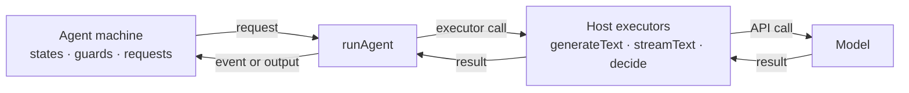

# Stately Agent

**Make invalid agent actions impossible.**

Agent logic as state machines: deterministic, inspectable, resumable, runs anywhere. The machine owns control flow; the model only ever picks a legal event. Testing, inspection, and visualization fall out for free.

Stately Agent adds model requests and decisions to XState:

- The machine defines what the agent can do.
- Your application chooses the model, runs the requests, and stores the state.
- The model proposes an event; the machine decides whether it is allowed and what happens next.

Environment and policy:

- The environment is code you own and can verify; the policy is something a model can write inside it.
- The environment holds the rules and invariants as TypeScript states and guards, fixed and checked with `canReach`.
- The policy is a JSON machine a model can author and improve from traces, gated before it runs and promoted only on a measured gain. See [Environment and policy](https://github.com/statelyai/agent/blob/next/docs/environment-and-policy.md).

Stately Agent 2 is in alpha. APIs may change before the stable release.

[Documentation](https://stately.ai/docs/packages/agent) · [Examples](https://github.com/statelyai/agent/blob/next/examples/README.md) · [XState](https://github.com/statelyai/xstate)

## Four starting points

- **Author a new agent.** Build a machine from states, decisions, and typed requests; run it locally with `runAgent`, test it with no API key, then use it in any framework or runtime with zero machine changes. See the [Quickstart](https://github.com/statelyai/agent/blob/next/docs/quickstart.md) and [Use in any stack](https://github.com/statelyai/agent/blob/next/docs/any-stack.md).
- **Retrofit an existing agent.** Turn a `while` loop into a machine: your SDK calls, tools, and retry code become the executors; the machine replaces only the control flow. See [Migrating from a hand-rolled loop](https://github.com/statelyai/agent/blob/next/docs/from-a-loop.md).
- **Copy a known pattern.** ReAct, reflection, plan-and-execute, RAG, supervisor, and more, each a single runnable file you lift in 60 seconds. See [Agent patterns](https://github.com/statelyai/agent/blob/next/docs/patterns.md).
- **Let an agent improve its own logic.** Keep the rules in a fixed TypeScript environment and let a model rewrite the JSON policy inside it, gated by `verifyAgentConfig` and promoted only when held-out scenarios improve. See [Environment and policy](https://github.com/statelyai/agent/blob/next/docs/environment-and-policy.md) and the [`improve-machine` skill](https://github.com/statelyai/agent/blob/next/skills/improve-machine/SKILL.md).

## Install

<!-- install command matching the package prerelease channel and package.json peers -->

```sh
pnpm add @statelyai/agent@alpha xstate@6.0.0-alpha.69 zod
```

XState is pinned while its experimental durable restoration API evolves.

For the optional Vercel AI SDK executor:

```sh
pnpm add ai@^7 @ai-sdk/openai@^4
```

For the optional raw OpenAI SDK executor (`@statelyai/agent/openai`):

```sh
pnpm add openai
```

For the optional TanStack AI executor (`@statelyai/agent/tanstack-ai`):

```sh
pnpm add @tanstack/ai @tanstack/ai-openai
```

Classification, grading, relevance, and yes/no checks are judgments: call the AI SDK's `experimental_decide` with `@ai-sdk/typesafe-ai` (`pnpm add ai @ai-sdk/typesafe-ai`) from an ordinary actor; see [Judgments with the AI SDK](https://github.com/statelyai/agent/blob/next/docs/judgments.md).

Requirements:

- Node 22 or newer, and XState exactly `6.0.0-alpha.69`.
- TypeScript 5.4 or newer. Older versions accept the code, but callback parameters in `createMachine` silently become `any`.
- A [Standard Schema](https://standardschema.dev) library: zod 4, zod 3.24 or newer, Valibot, or ArkType. `setupAgent` throws `invalid-schema` for zod 3.23 and earlier.
- The package is ESM-first. CommonJS builds are published too, so `require()` works. Subpath imports (`@statelyai/agent/testing`) resolve under every `moduleResolution`, including `node`.
- Provider packages must match your `ai` major: `@ai-sdk/openai@^4` pairs with `ai@^7`. A bare `@ai-sdk/openai` resolves to `@latest`, which can mismatch the `ai` peer. `@statelyai/agent/openai` needs `openai` 5 or newer.

An app that already uses XState 4 or 5 keeps it: put the agent in its own workspace package. See [Use in an XState 4 or 5 app](https://github.com/statelyai/agent/blob/next/docs/xstate-4-and-5-apps.md). If both versions land in one `node_modules`, the package fails with errors that do not mention a version:

| Error | Cause |
| --- | --- |
| `createAsyncLogic is not a function` | `xstate` resolved to 4 or 5 from CommonJS |
| `Cannot find module '…/node_modules/xstate/durable'` | `xstate` resolved to 4 or 5 from ESM |
| `unmet peer dependency "xstate@6.0.0-alpha.69"` (pnpm, npm) or `has incorrect peer dependency "xstate@6.0.0-alpha.69"` (yarn 1) | The install's only warning of the two above |

## Agent skills

The package ships agent skills in `node_modules/@statelyai/agent/skills/`. Copy them into your coding agent's skills directory (for Claude Code, `.claude/skills/`):

```sh
cp -R node_modules/@statelyai/agent/skills/* .claude/skills/
```

| Skill | What it does |
| --- | --- |
| [`graph-engineering`](https://github.com/statelyai/agent/blob/next/skills/graph-engineering/SKILL.md) | Finds which step a project is at and routes to the next skill |
| [`loop-to-machine`](https://github.com/statelyai/agent/blob/next/skills/loop-to-machine/SKILL.md) | Converts existing agent code into a machine and checks parity with `compareRuns` |
| [`generate-machine`](https://github.com/statelyai/agent/blob/next/skills/generate-machine/SKILL.md) | Authors a JSON policy machine from scratch and runs `verifyAgentConfig` |
| [`add-traces`](https://github.com/statelyai/agent/blob/next/skills/add-traces/SKILL.md) | Stamps and persists every run so it replays |
| [`add-evals`](https://github.com/statelyai/agent/blob/next/skills/add-evals/SKILL.md) | Writes evals per state, at the cheapest level that catches the failure |
| [`improve-machine`](https://github.com/statelyai/agent/blob/next/skills/improve-machine/SKILL.md) | Improves a policy from traces and hands the change to a person as a pull request |

## Quick start

<!-- refund decision example using setupAgent, agent.decide, a machine guard, and the AI SDK runAgent host -->

This agent reviews refund requests. The model may propose an automatic refund, but the state machine owns the $100 limit.

```ts
import { runAgent, setupAgent } from "@statelyai/agent";
import { z } from "zod";

const agentSetup = setupAgent({
  context: z.object({
    request: z.string(),
    amount: z.number(),
  }),
  input: z.object({
    request: z.string(),
    amount: z.number(),
  }),
  output: z.object({
    outcome: z.enum(["refunded", "review"]),
  }),
  events: {
    AUTO_REFUND: {},
    REVIEW: z.object({ reason: z.string() }),
  },
});

const refundMachine = agentSetup.createMachine({
  context: ({ input }) => input,
  initial: "deciding",
  states: {
    deciding: {
      invoke: {
        src: "agent.decide",
        input: ({ context }) => ({
          model: "fast",
          system: "Choose AUTO_REFUND for eligible requests. Otherwise choose REVIEW.",
          prompt: `${context.request}\nAmount: $${context.amount}`,
          allowedEvents: ["AUTO_REFUND", "REVIEW"],
        }),
      },
      on: {
        AUTO_REFUND: ({ context }) => (context.amount <= 100 ? { target: "refunded" } : undefined),
        REVIEW: { target: "review" },
      },
    },
    refunded: {
      type: "final",
      output: () => ({ outcome: "refunded" }),
    },
    review: {
      type: "final",
      output: () => ({ outcome: "review" }),
    },
  },
});

const result = await runAgent(refundMachine, {
  input: {
    request: "I was charged twice for the same order.",
    amount: 75,
  },
  // An executor is a plain function, so this run needs no API key and no
  // provider package.
  executors: { decide: async () => ({ event: { type: "AUTO_REFUND" } }) },
});

if (result.status === "done") {
  console.log(result.output);
}
```

When the machine reaches `refunded`, the result is:

```text
{ outcome: 'refunded' }
```

The model chooses between the events allowed in `deciding`. The `AUTO_REFUND` transition only works when the amount is at most $100. If the model chooses it for a larger amount, the guard rejects the choice and the decision is tried again.

To call a real model, leave the states unchanged. Declare the model once on the setup by adding `models` to the `setupAgent` call above, and hand the machine to the AI SDK adapter:

```ts
import { openai } from "@ai-sdk/openai";
import { createAiSdkExecutors } from "@statelyai/agent/ai-sdk";

// In the setupAgent({ ... }) call above:
//   models: { fast: openai("gpt-6-luna") },

const liveResult = await runAgent(refundMachine, {
  input: { request: "I was charged twice for the same order.", amount: 75 },
  executors: createAiSdkExecutors(refundMachine),
});
```

`createAiSdkExecutors(refundMachine)` reads the `models` declared in `setupAgent({ models })`, which also type the machine's model refs. `createAiSdkExecutors({ models })` still works when the host owns the map. Executors are always explicit, and core does not import the AI SDK. See [Models and providers](https://github.com/statelyai/agent/blob/next/docs/models-and-providers.md) and [Hosts and executors](https://github.com/statelyai/agent/blob/next/docs/hosts.md).

For a machine with several requests, the executor routes on `request.name`, or `MockLanguageModelV3` from `ai/test` stands in for the provider behind `createAiSdkExecutors`. See [Evals](https://github.com/statelyai/agent/blob/next/docs/evals.md#testing-without-a-provider).

A host that needs the transition loop itself (a durable object, events pushed mid-run, a custom checkpoint policy) uses `createAgentRuntime` directly. See [Write your own host loop](https://github.com/statelyai/agent/blob/next/docs/hosts.md#write-your-own-host-loop).

## Architecture



The machine never talks to a model directly, so swapping `createAiSdkExecutors` for your own functions changes nothing about the agent.

The example above has one model decision and two final outcomes. Real machines add approval states, retries, parallel work, child agents, and long-running waits without changing how control flow is represented.

The core concepts (machines owning control flow, bounded model decisions, typed requests, host-run executors, and native XState snapshots) are in the [documentation overview](https://github.com/statelyai/agent/blob/next/docs/index.md).

## Examples

<!-- starter examples derived from examples/*/metadata.json and examples/index.ts -->

- [Twenty Questions](https://github.com/statelyai/agent/tree/next/examples/twenty-questions) shows a model choosing legal events in a loop.
- [Chameleon](https://github.com/statelyai/agent/tree/next/examples/chameleon) combines hidden information, sequential turns, and a human vote.
- [Snapshot migration](https://github.com/statelyai/agent/tree/next/examples/snapshot-migration) uses XState's native `version` and `migrate` contract.
- [Portable XState loop](https://github.com/statelyai/agent/tree/next/examples/portable-xstate-loop) runs the artifact through native transitions and effects.
- [Application-owned storage](https://github.com/statelyai/agent/tree/next/examples/file-snapshot-store) persists native XState snapshots in application code.
- [Tool calling](https://github.com/statelyai/agent/tree/next/examples/review-tool-calls) keeps tools and message history in the AI SDK's native format.
- [Ticket triage](https://github.com/statelyai/agent/tree/next/examples/triage) returns structured data from a model request.
- [JSON agent](https://github.com/statelyai/agent/tree/next/examples/json-agent) runs a machine defined as data.

See [all examples](https://github.com/statelyai/agent/blob/next/examples/README.md).

## Related

- [Machines](https://github.com/statelyai/agent/blob/next/docs/machines.md)
- [Text requests](https://github.com/statelyai/agent/blob/next/docs/text-requests.md)
- [Decisions](https://github.com/statelyai/agent/blob/next/docs/decisions.md)
- [Human in the loop](https://github.com/statelyai/agent/blob/next/docs/human-in-the-loop.md)
- [Testing and verification](https://github.com/statelyai/agent/blob/next/docs/verify.md)
- [Evals](https://github.com/statelyai/agent/blob/next/docs/evals.md)
- [Generating machines with an LLM](https://github.com/statelyai/agent/blob/next/docs/generate-machines.md)
- [Hosts and executors](https://github.com/statelyai/agent/blob/next/docs/hosts.md)
- [Models and providers](https://github.com/statelyai/agent/blob/next/docs/models-and-providers.md)
- [Use in any stack](https://github.com/statelyai/agent/blob/next/docs/any-stack.md)
- [Persistence](https://github.com/statelyai/agent/blob/next/docs/persistence.md)
- [Observability](https://github.com/statelyai/agent/blob/next/docs/observability.md)
- [Usage and budgets](https://github.com/statelyai/agent/blob/next/docs/usage-and-budgets.md)
- [Agent patterns](https://github.com/statelyai/agent/blob/next/docs/patterns.md)
- [Migrating from a hand-rolled loop](https://github.com/statelyai/agent/blob/next/docs/from-a-loop.md)
- [Coming from LangGraph](https://github.com/statelyai/agent/blob/next/docs/langgraph-comparison.md)
